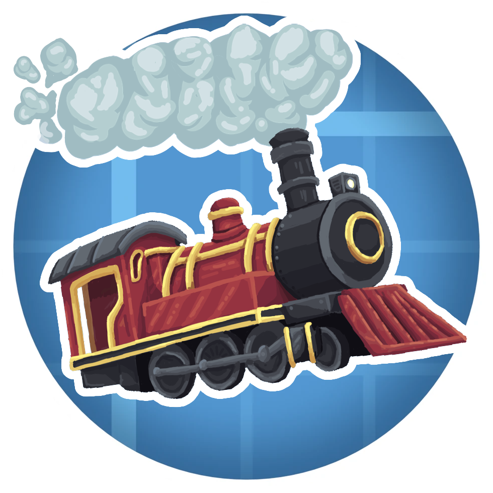

  

<h1 align="center">Create: Loconautics</h1>

  

Create: Loconautics is a Create addon for NeoForge 1.21.1 that makes Create trains work with Sable. Instead of Create's carriage contraption entities, every train car is a Sable sub level, so a train is a real physics body. It can bump into things, derail, cross portals and carry other sub levels.

On top of that it adds bogeys, knuckle couplers, an analog controller, a locomotive instrument panel with gauges, rail carriages, turntables, hoses, schedules and train mail.

## Compatibility

This mod reaches deep into Create, Sable and Create Simulated with mixins. A new version of any of them can break it, and other mods that touch trains may not get along with it. It has optional support for Burnt and CC: Tweaked, and the panel gauges can read blocks from Create: Aeronautics, Create: Propulsion and Create: Diesel Generators when they are installed.

## Requirements

- Minecraft 1.21.1 with NeoForge 21.1 or newer
- Create 6.0
- Sable 2.0
- Create Simulated 1.3

## Developers

Sable and Simulated are the only hard dependencies. Their jars are not in this repo: drop the Sable jar and either the Simulated jar or the Create Aeronautics bundle (which carries Simulated) in `run/mods`, then run `./gradlew runClient`. Railways, Burnt, CC: Tweaked, Create: Aeronautics, Create: Propulsion and Create: Diesel Generators are optional and only read by name, so none of them is needed to build. Gradle unpacks the bundled libraries it needs for compiling from the Sable jar by itself.

## Translations

English is the main language. The other languages are community work, and more help is welcome.

| Language | Translated |
| --- | --- |
| English (en_us) | 100% |
| German (de_de) | 63% |
| Spanish (es_es) | 29% |

Want to add a language or finish one? Copy `src/main/resources/assets/loconautics/lang/en_us.json`, name it for your language (for example `fr_fr.json`), translate the values and leave the keys as they are. Then open a pull request, or ask on Discord. A partial translation is fine, any missing text shows in English.

## Thanks

- Lyc and MDLOP, development
- Basilforrealss, TugKanTheMan and Hatchet, art
- ZyxBe, MaxweLi, Bwah, Popochka, GoldenPants, Čipollø and Miat, testing.
- The Create team, for the trains this is built around.
- RyanHCode and the Sable team, for the physics.
- Dimforge, for Rapier.

## License

The code is MIT. The art, including the icon above, is all rights reserved. Both are spelled out in `LICENSE`.
